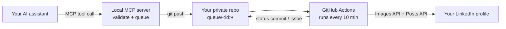

# linkedin-scheduler-mcp

An MCP server that lets any AI assistant publish and schedule LinkedIn posts, with an image, on your personal profile. Scheduled posts are published from GitHub Actions, so **your computer can be switched off when they go out.**

Write the post with your assistant, approve it, and say "schedule this for Tuesday 08:30". The post and its image go live at that time from the cloud.

Works with any MCP client: Claude Desktop, Claude Code, OpenAI Codex (CLI and IDE extension), Cursor, VS Code with GitHub Copilot, Gemini CLI, Windsurf and Warp.

> Independent project. Not affiliated with, endorsed by or sponsored by LinkedIn Corporation or Microsoft. "LinkedIn" is a trademark of LinkedIn Corporation, used here only to describe what this software connects to.

---

## Features

- **Scheduled publishing with your computer off.** Posts are queued in a private GitHub repository and published by a GitHub Actions workflow at the scheduled time.
- **Publish now.** One tool call queues the post and triggers the publisher immediately.
- **Text plus image.** PNG, JPG or GIF, uploaded through LinkedIn's Images API, with alt text.
- **Official API only.** Uses LinkedIn's self-serve "Share on LinkedIn" product (`w_member_social`). No scraping, no browser automation, no session cookies.
- **No duplicates.** A post is claimed in git *before* LinkedIn is called, and an ambiguous outcome is never retried.
- **Approved means unchanged.** Text and image are hashed when queued; the publisher refuses anything that changed afterwards.
- **Never posted late.** Each post has a publishing window; if it is missed, the post is marked expired and you are notified instead.
- **Spacing rule.** Posts closer together than a configurable minimum gap (default 12 hours) are rejected.
- **Correct text, every character.** LinkedIn's reserved characters (`| { } @ [ ] ( ) < > # \ * _ ~`) are escaped automatically, so brackets, hashtags-as-text and backslashes appear exactly as written.
- **Time-zone aware.** Schedule in your own wall-clock time; daylight-saving changes are handled.
- **Full audit trail.** Every queue, publish, cancel and failure is a git commit.
- **Kill switch.** One repository variable stops all publishing.
- **Health checks.** A weekly workflow warns before your token expires, when the API version is getting old, or if a post is stuck.
- **Failures you will see.** Every problem opens a GitHub issue, which reaches you by email and GitHub mobile notifications.

---

## How it works



1. The local MCP server validates the post (length, image, timing, spacing, token expiry), writes `queue/<id>/` (post text, image, status) and pushes it to your private repository.
2. `.github/workflows/publish.yml` runs every 10 minutes during your publishing hours, picks up the post that is due, uploads the image and publishes it.
3. The result is committed back as `published`, with the post URL.

Post states: `scheduled` → `publishing` → `published`, or `cancelled`, `expired`, `needs_attention`.

---

## Requirements

- A LinkedIn account
- A GitHub account and the [GitHub CLI](https://cli.github.com/) (`gh`), logged in with the `repo` and `workflow` scopes
- Node.js 24 or newer
- git
- Any MCP-capable AI client

---

## Setup

About 20 minutes, once.

### 1. Create your own private copy

Your queue holds unpublished drafts, so your copy must be **private**. GitHub does not allow private forks of public repositories, so clone and push instead:

```bash
git clone https://github.com/<UPSTREAM_OWNER>/linkedin-scheduler-mcp.git
cd linkedin-scheduler-mcp
gh repo create <YOUR_GITHUB_USER>/<YOUR_PRIVATE_REPO> --private --source . --remote origin --push
git remote add upstream https://github.com/<UPSTREAM_OWNER>/linkedin-scheduler-mcp.git
npm install
```

Pull future updates with `git pull upstream main`.

### 2. Create a LinkedIn developer app

1. Go to <https://www.linkedin.com/developers/apps/new>.
2. **App name:** anything that does not contain "LinkedIn", "Linked" or "In".
3. **LinkedIn Page:** type `Default Company Page for Individual Developer` and select it from the dropdown. You do **not** need your own Company Page.
   - Do **not** pick "Member Data Portability (Member-Only Default Company Page)". It locks the products you need, and the page cannot be changed after the app is saved.
4. **Privacy policy URL:** optional.
5. **App logo:** any square image of at least 100 px.
6. Accept the terms and click **Create app**.
7. **Products** tab: click **Request access** on **Share on LinkedIn** and on **Sign In with LinkedIn using OpenID Connect**. Both activate immediately.
8. **Auth** tab → **Authorized redirect URLs for your app**: add exactly

   ```
   http://localhost:8765/callback
   ```

9. Keep the **Auth** tab open. You will need the **Client ID** and **Primary Client Secret** in step 4. Never paste the secret into a chat or a file.

### 3. Configure your repository

Edit `publisher.config.json`:

```json
{
  "timezone": "<IANA_TIME_ZONE>",
  "windowMinutes": 135,
  "minGapHours": 12,
  "scheduleStartUtc": "05:00",
  "scheduleEndUtc": "09:50",
  "sourceDir": null,
  "requireVerificationHeading": null
}
```

- `timezone`: your IANA time zone, for example `Europe/London` or `America/New_York`. Scheduling times are given in this zone.
- `windowMinutes`: how late a post may still go out.
- `minGapHours`: minimum time between two posts.
- `scheduleStartUtc` / `scheduleEndUtc`: the hours the publisher runs. **Keep the `cron` line in `.github/workflows/publish.yml` in sync** (default `7,17,27,37,47,57 5-9 * * *`, every 10 minutes from 05:07 to 09:57 UTC, off the hour on purpose).
- `sourceDir` (optional): if set, `source_path` arguments must be inside this folder.
- `requireVerificationHeading` (optional): if set (for example `"## Review"`), source files must contain that heading with content before they can be queued, and posts given as plain `text` are refused.

Then set the repository variables:

```bash
gh variable set LINKEDIN_API_VERSION --body <YYYYMM>
gh variable set PUBLISHING_ENABLED --body true
gh variable set DRY_RUN --body false
gh label create publisher --description "Raised by the LinkedIn publisher"
```

Use the latest version listed at <https://learn.microsoft.com/en-us/linkedin/marketing/versioning>.

Commit and push the config:

```bash
git add publisher.config.json .github/workflows/publish.yml
git commit -m "Configure publisher"
git push
```

### 4. Log in to LinkedIn

```bash
npm run login
```

1. Enter your **Client ID**.
2. Enter your **Client Secret** at the hidden prompt. On macOS both are saved in the Keychain; on Linux and Windows you are asked each time.
3. Your browser opens LinkedIn's consent screen. Click **Allow**.
4. The script stores your access token and member ID as GitHub Actions secrets (`LINKEDIN_ACCESS_TOKEN`, `LINKEDIN_PERSON_URN`) and the expiry date as the variable `LINKEDIN_TOKEN_EXPIRES_AT`. The token is never printed or written to disk.

LinkedIn tokens last 60 days. Run `npm run login` again when the health check opens a renewal issue.

### 5. Connect your AI assistant

Every client runs the same command. Use absolute paths:

- **command:** `<ABSOLUTE_PATH_TO_NODE>` (find it with `command -v node`)
- **args:** `<ABSOLUTE_PATH_TO_REPO>/src/mcp/server.ts`
- **env:** `LP_REPO_DIR=<ABSOLUTE_PATH_TO_REPO>`

Some clients do not load your shell profile. If the server cannot find `git` or `gh`, add a `PATH` entry to `env` that includes their folders.

<details>
<summary><b>Claude Desktop</b></summary>

Settings → Developer → Edit Config (`claude_desktop_config.json`):

```json
{
  "mcpServers": {
    "linkedin-scheduler": {
      "command": "<ABSOLUTE_PATH_TO_NODE>",
      "args": ["<ABSOLUTE_PATH_TO_REPO>/src/mcp/server.ts"],
      "env": { "LP_REPO_DIR": "<ABSOLUTE_PATH_TO_REPO>" }
    }
  }
}
```

Quit and reopen Claude Desktop.
</details>

<details>
<summary><b>Claude Code</b></summary>

```bash
claude mcp add --env LP_REPO_DIR=<ABSOLUTE_PATH_TO_REPO> --scope user --transport stdio \
  linkedin-scheduler -- <ABSOLUTE_PATH_TO_NODE> <ABSOLUTE_PATH_TO_REPO>/src/mcp/server.ts
claude mcp list
```

Keep another option between `--env` and the server name; otherwise the CLI reads the name as a second `KEY=value` pair.
</details>

<details>
<summary><b>OpenAI Codex (CLI and IDE extension)</b></summary>

With the CLI:

```bash
codex mcp add linkedin-scheduler --env LP_REPO_DIR=<ABSOLUTE_PATH_TO_REPO> -- <ABSOLUTE_PATH_TO_NODE> <ABSOLUTE_PATH_TO_REPO>/src/mcp/server.ts
```

Or in `~/.codex/config.toml`, which the CLI and the IDE extension share:

```toml
[mcp_servers.linkedin-scheduler]
command = "<ABSOLUTE_PATH_TO_NODE>"
args = ["<ABSOLUTE_PATH_TO_REPO>/src/mcp/server.ts"]
env = { LP_REPO_DIR = "<ABSOLUTE_PATH_TO_REPO>" }
```
</details>

<details>
<summary><b>Cursor</b></summary>

`~/.cursor/mcp.json` (global) or `.cursor/mcp.json` (one project):

```json
{
  "mcpServers": {
    "linkedin-scheduler": {
      "type": "stdio",
      "command": "<ABSOLUTE_PATH_TO_NODE>",
      "args": ["<ABSOLUTE_PATH_TO_REPO>/src/mcp/server.ts"],
      "env": { "LP_REPO_DIR": "<ABSOLUTE_PATH_TO_REPO>" }
    }
  }
}
```
</details>

<details>
<summary><b>VS Code with GitHub Copilot</b></summary>

`.vscode/mcp.json` in a workspace, or run **MCP: Open User Configuration** for all workspaces. Note the `servers` key:

```json
{
  "servers": {
    "linkedin-scheduler": {
      "type": "stdio",
      "command": "<ABSOLUTE_PATH_TO_NODE>",
      "args": ["<ABSOLUTE_PATH_TO_REPO>/src/mcp/server.ts"],
      "env": { "LP_REPO_DIR": "<ABSOLUTE_PATH_TO_REPO>" }
    }
  }
}
```
</details>

<details>
<summary><b>Gemini CLI</b></summary>

`~/.gemini/settings.json`:

```json
{
  "mcpServers": {
    "linkedin-scheduler": {
      "command": "<ABSOLUTE_PATH_TO_NODE>",
      "args": ["<ABSOLUTE_PATH_TO_REPO>/src/mcp/server.ts"],
      "env": { "LP_REPO_DIR": "<ABSOLUTE_PATH_TO_REPO>" }
    }
  }
}
```

Run `/mcp` inside Gemini CLI to see the server and its tools.
</details>

<details>
<summary><b>Windsurf (Cascade)</b></summary>

`~/.codeium/windsurf/mcp_config.json`, using the same `mcpServers` block as Claude Desktop.
</details>

<details>
<summary><b>Warp</b></summary>

Settings → Agents → MCP servers → **+ Add**, and paste the same `mcpServers` block as Claude Desktop. Or add it to `~/.warp/.mcp.json`; Warp picks up changes on save.
</details>

### 6. Publish your first post

Start with a post visible only to your connections:

> Post this to LinkedIn now, visibility CONNECTIONS, with the image `<ABSOLUTE_PATH_TO_IMAGE>`: "Testing my new publishing setup."

Then schedule one:

> Schedule this post for tomorrow 08:30 with this image.

The assistant reads back the exact time in your zone and in UTC before anything is queued.

---

## Tools

| Tool | What it does |
| --- | --- |
| `schedule_post` | Validate and queue a post with an image at a local time (`"YYYY-MM-DD HH:mm"`) in your configured zone. |
| `post_now` | Validate, queue and publish immediately. |
| `list_scheduled` | Every queued post with its state, time and URL once published. |
| `cancel_post` | Cancel a post that is still `scheduled`. |
| `reschedule_post` | Move a `scheduled` post to a new time; text and image stay locked. |
| `publisher_status` | Token expiry, API version, switches, recent runs and open issues. |

`schedule_post` and `post_now` take either `text` (the post body) or `source_path` (a Markdown file whose post body is the first fenced code block), plus `image_path`, an optional `visibility` (`PUBLIC` or `CONNECTIONS`, default `PUBLIC`) and optional `alt_text` (defaults to the first line of the post).

---

## Repository variables and secrets

| Name | Type | Purpose |
| --- | --- | --- |
| `PUBLISHING_ENABLED` | variable | Must be `true` for the workflows to run at all. Set to `false` to stop everything. |
| `DRY_RUN` | variable | Anything other than `false` logs the exact request without sending it (with `PUBLISHING_ENABLED` set to `true`). |
| `LINKEDIN_API_VERSION` | variable | `YYYYMM`. Update at least once a year. |
| `LINKEDIN_SEND_ALT_TEXT` | variable | Set to `false` to omit image alt text. |
| `LINKEDIN_TOKEN_EXPIRES_AT` | variable | Written by `npm run login`. |
| `LINKEDIN_ACCESS_TOKEN` | secret | Written by `npm run login`. |
| `LINKEDIN_PERSON_URN` | secret | Written by `npm run login`. |

---

## Safety model

- **Claim before calling.** `publishing` is committed and pushed before any LinkedIn request. If that push fails, nothing is posted.
- **No blind retries.** Only definite rejections about media processing are retried. A server error, a timeout or a missing post ID may mean the post exists, so the post is set to `needs_attention` and an issue is opened.
- **One post per run.** The publisher never publishes two posts in one run.
- **Locked content.** The hash taken at queue time must match at publish time.
- **Late means skipped.** A missed window expires the post rather than publishing it late.
- **No third-party actions.** The workflows use only GitHub's own `checkout` and `setup-node` actions, pinned to commit SHAs, and the cloud path has no npm dependencies.

---

## Operations

**Stop everything**

```bash
gh variable set PUBLISHING_ENABLED --body false
```

**Renew the token** (about every 60 days, when the renewal issue appears)

```bash
npm run login
```

**A post needs attention**

Open the issue, check your LinkedIn activity, then edit `queue/<id>/status.json` by hand. Posts in `needs_attention` or `publishing` are never retried automatically.

**Update the API version** (when the health check asks)

```bash
gh variable set LINKEDIN_API_VERSION --body <YYYYMM>
```

---

## Limitations

- Personal profiles only. Company Pages need LinkedIn's Community Management API, which is restricted to registered organisations.
- One image per post. Carousels, documents, video and polls are not supported.
- LinkedIn gives individual developers 60-day tokens without refresh tokens, so you log in again every two months.
- The API cannot read engagement on your posts (`r_member_social` is closed to new apps).
- GitHub Actions may start scheduled runs a few minutes late, especially at the top of the hour. The schedule runs off the hour and the publishing window absorbs the delay.

---

## Development

```bash
npm test
```

Unit tests cover escaping, hashing, time-zone conversion across daylight-saving changes, the state machine, validation and source-file parsing.

---

## License

MIT. See [LICENSE](LICENSE).
